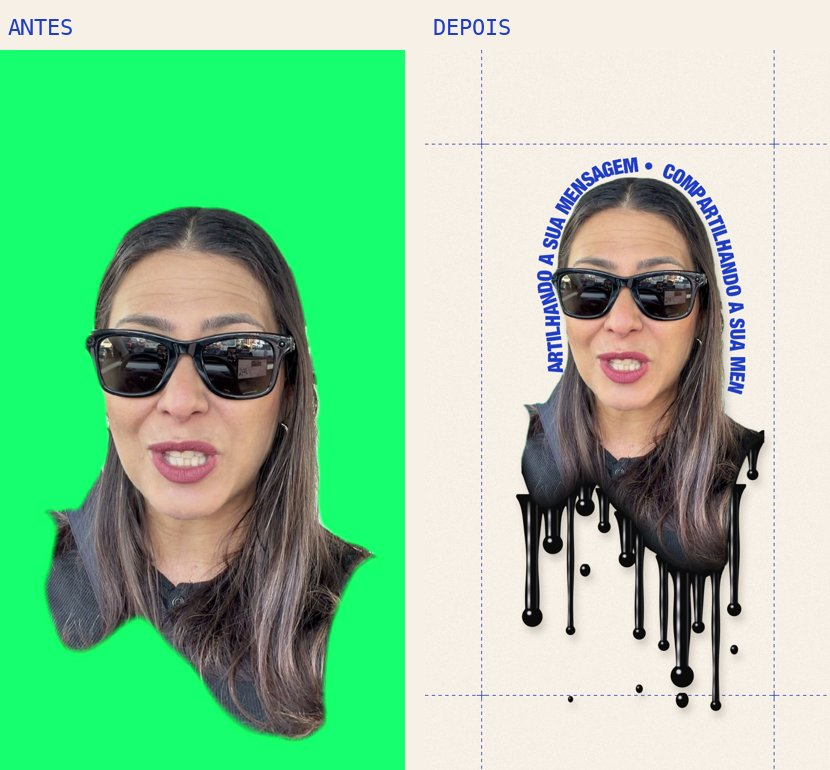
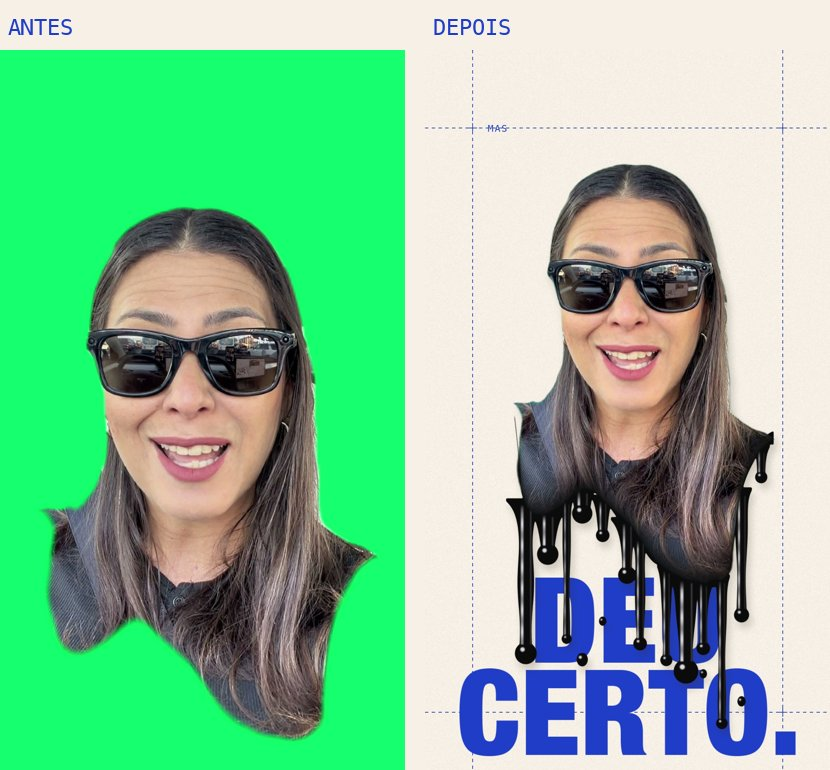

# Colagem derretendo

Skill do Claude Code que edita o seu vídeo falado no estilo colagem editorial: você recortado sobre um papel bege, com a parte de baixo do corpo **derretendo em tinta preta brilhante**. Em volta entram palavras gigantes azuis, uma grade pontilhada, o rosto em meio-tom ou azul, frases girando em volta da cabeça, letreiros e cenas dentro dos óculos escuros, uma parede de quadros seus que aparece quando a câmera abre, adesivos, uma lista em papel pautado, um carimbo, um comentário e efeitos sonoros.

Funciona com fundo verde ou com qualquer fundo: o recorte automático do Mac separa você do cenário.

| Antes | Depois |
| --- | --- |
|  |  |

**[Guia passo a passo com imagens](guia/README.md)**, inclusive como fazer um efeito parecido sem instalar nada (CapCut + Canva).

## Como usar

Peça ao Claude algo como:

> Usa a skill colagem-derretendo neste vídeo: /Users/eu/Downloads/meu-video.MOV. Abre em meio-tom, coloca as palavras de impacto gigantes embaixo de mim, uma frase girando em volta da minha cabeça e a parede de quadros quando eu falar "imagina".

Ele prepara o vídeo, lê a sua fala, escreve um roteiro de efeitos, mostra quadros para você aprovar e renderiza. Você recebe:

- `final.mp4`: o vídeo pronto, com efeitos sonoros;
- `final-camada-textos.mov`: só os textos, com fundo transparente, para ajustar no CapCut;
- `final-sfx.wav`: os efeitos sonoros separados.

## Requisitos

macOS, `ffmpeg` e Python 3 com `pillow`, `numpy` e `faster-whisper`:

```bash
brew install ffmpeg
pip3 install pillow numpy faster-whisper
```

## Dicas de gravação

- Vídeo vertical, de frente para a câmera, do peito para cima. Os efeitos de lentes só aparecem com **óculos escuros**.
- Fundo liso (ou verde) deixa o recorte mais limpo. Com fundo bagunçado ou roupa da cor da parede, o contorno pode tremer.
- Fale em frases curtas, com uma palavra forte em cada: é nela que entra a palavra gigante.
