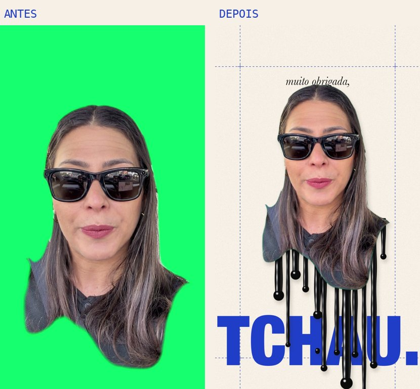
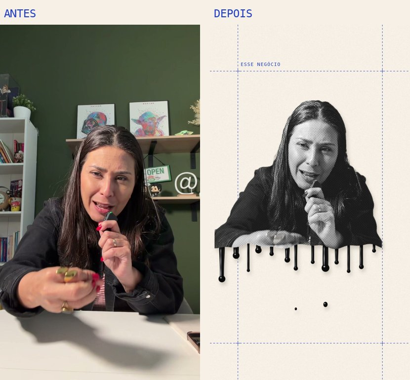
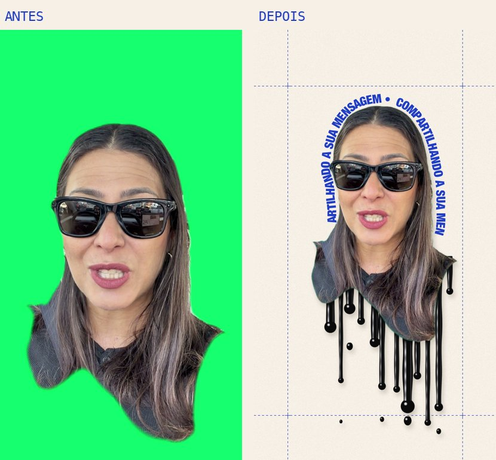
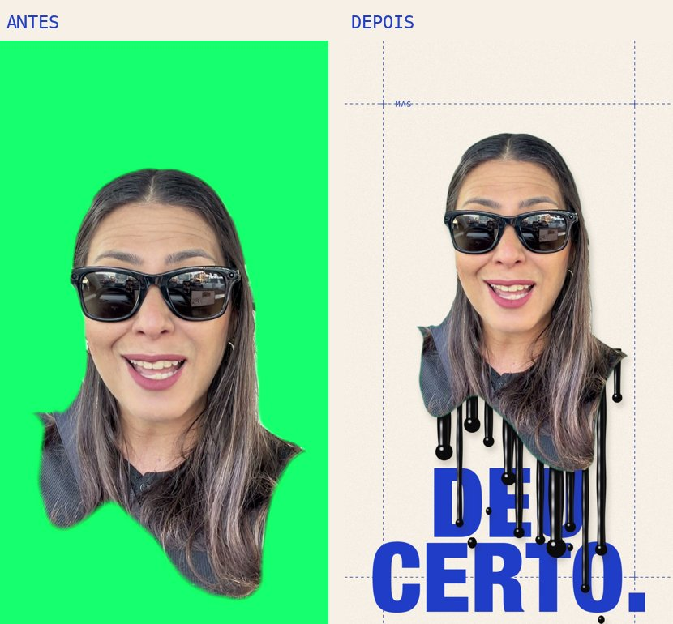
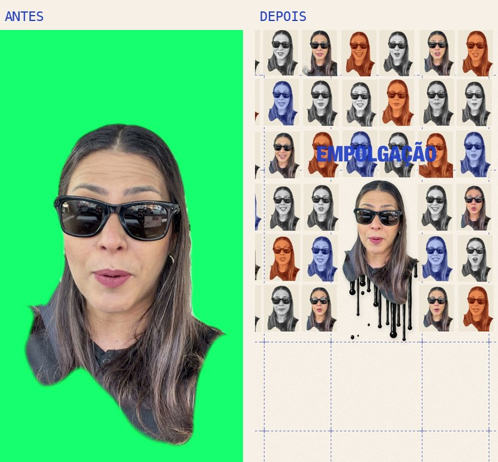
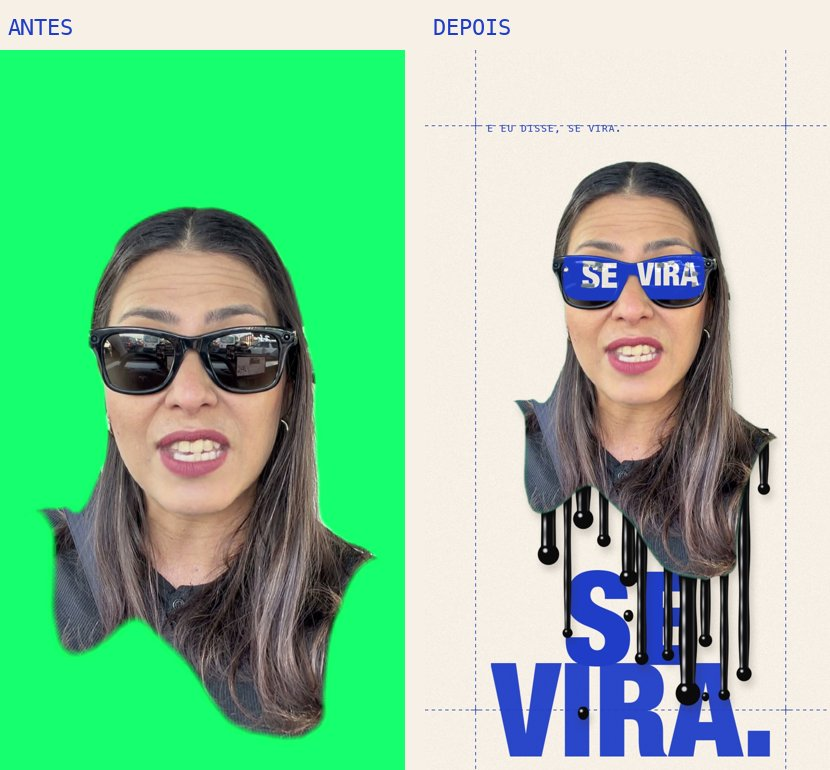

# Guia: colagem derretendo

Como fazer o vídeo em que a pessoa derrete em tinta preta no meio de uma colagem editorial: grade azul, palavras gigantes, meio-tom, frases em volta da cabeça e cenas dentro dos óculos escuros.



Tem dois caminhos:

- **[Caminho 1: com o Claude Code](#caminho-1-com-o-claude-code)**. Você pede em português e o Claude faz a edição inteira, com efeitos sonoros. Precisa de um Mac.
- **[Caminho 2: sem instalar nada](#caminho-2-sem-instalar-nada-capcut--canva--gemini)**. CapCut + Canva + Gemini, à mão. Dá um resultado parecido e funciona em qualquer celular ou computador.

---

## Caminho 1: com o Claude Code

### O que instalar (uma vez só)

1. **Claude Code**: baixe em [claude.com/claude-code](https://claude.com/claude-code) (app desktop ou terminal).
2. **ffmpeg e Python**: no Terminal do Mac:
   ```bash
   brew install ffmpeg
   pip3 install pillow numpy faster-whisper
   ```
   Sem o `brew`? Instale antes em [brew.sh](https://brew.sh). Ou peça ao próprio Claude Code: *"instala o ffmpeg e as bibliotecas pillow, numpy e faster-whisper pra mim"*.
3. **A skill**: baixe [este repositório](https://github.com/mikmachado/skills-publicas) (botão verde **Code → Download ZIP**) e copie a pasta `edicao-de-video/colagem-derretendo` para `~/.claude/skills/`:
   ```bash
   mkdir -p ~/.claude/skills
   cp -R skills-publicas/edicao-de-video/colagem-derretendo ~/.claude/skills/
   ```

### Como gravar

- Vertical, de frente, do peito para cima, com **óculos escuros** se quiser as cenas nas lentes.
- Fundo liso ou verde deixa o recorte mais limpo. Funciona com qualquer fundo, mas parede da mesma cor da roupa atrapalha.
- Frases curtas, cada uma com uma palavra forte.

### A listinha de comandos

Abra o Claude Code numa pasta vazia e vá pedindo. Os 6 passos abaixo são os mesmos da lista que aparece no vídeo.

#### 01 · Recortar a pessoa
> Usa a skill colagem-derretendo. Prepara este vídeo: /Users/eu/Downloads/meu-video.MOV

O Claude converte para 9:16, recorta você do fundo (pelo verde ou pelo recorte automático do Mac, como neste exemplo com sala, estante e mesa), acha o rosto e os olhos e transcreve a fala. Confira a transcrição: nomes e gírias costumam sair errados.



#### 02 · Tinta preta derretendo
> Coloca o fundo bege claro e faz a parte de baixo do meu busto derreter em tinta preta brilhante, começando nos primeiros 3 segundos e escorrendo mais no final.

O corpo é cortado logo abaixo do queixo, numa linha ondulada, e a tinta escorre por trás do busto: o começo de cada pingo fica escondido atrás de você, então parece que a tinta sai de dentro da imagem, com bulbos, brilho e pingos caindo. Quer que o cabelo e a roupa escorram junto? Peça *"faz a minha imagem escorrer para dentro dos pingos"*. Mais ombro: *"corta o busto mais embaixo"*. Menos tinta: *"escorridos mais curtos"*.



#### 03 · Grade azul e palavras gigantes
> Abre em meio-tom preto e branco e passa pra cor na palavra "totalmente". Coloca uma legenda pequena digitando no topo, e as palavras de impacto gigantes em azul embaixo de mim.



#### 04 · Colagem de quadros em movimento
> Quando eu falar "empolgação", abre a câmera e mostra uma parede de quadros meus em meio-tom, azul e laranja, depois volta pra perto. E quando eu falar "estilo", enche a tela atrás de mim com a palavra ESTILO em fileiras.



#### 05 · Cenas dentro dos óculos
> Nos óculos escuros, coloca um letreiro "EDIÇÃO BEM CAPRICHOSA" passando, depois "SE" numa lente e "VIRA" na outra, e corações quando eu falar "curte". Faz uma frase girar em volta da minha cabeça em "compartilhando a sua mensagem".

Só funciona com óculos escuros. Sem óculos, a skill avisa e pula esse efeito.



#### 06 · Efeitos sonoros e o vídeo final
> Mostra uns quadros pra eu aprovar e depois renderiza o vídeo final com os efeitos sonoros.

Os sons entram sozinhos: pingos de tinta, batidas nas palavras gigantes, digitação nas legendas, whoosh quando a câmera abre, pop nos adesivos. Você recebe o vídeo, a camada só com os textos (fundo transparente, para mexer no CapCut) e os efeitos sonoros separados.

### Outros pedidos que funcionam

- *"Em 'olha onde eu estou', mostra o quadro original como uma foto com fita adesiva."*
- *"Quando eu falar das minhas ideias, joga uma chuva de adesivos em volta de mim."*
- *"Em 'separei uma lista', mostra um papel pautado com os itens digitando."*
- *"Coloca um carimbo APROVADO em 'deu certo'."*
- *"No final, um comentário escrito 'estilo' e o selo de curtidas."*
- *"Troca o azul por terracota"* (`"acento": "#E4572E"`) ou *"fundo rosa clarinho"*.
- *"Coloca esta música de fundo baixinho"*: a trilha abaixa sozinha quando você fala.

### Se algo sair estranho

| O que aconteceu | Peça assim |
| --- | --- |
| a tinta sai da mesa ou dos braços | "corta o busto mais perto do queixo" |
| fiquei pequena ou grande demais | "me aumenta um pouco" / "me diminui um pouco" |
| a palavra gigante sumiu atrás de mim | "coloca essa palavra mais embaixo" |
| o contorno do meu cabelo treme | regrave com fundo liso, ou "refaz o recorte nesse trecho" |

---

## Caminho 2: sem instalar nada (CapCut + Canva + Gemini)

**Paleta:** fundo bege `#F6F0E6`, azul `#1F3DC7`, preto `#141416`, laranja de carimbo `#E25C2C`.
**Fontes:** uma condensada bem pesada para as palavras gigantes (Anton, Bebas Neue ou Oswald Bold), uma serifa itálica para as frases leves (Baskerville ou Playfair Display Italic) e uma mono para as legendas pequenas (Space Mono, Courier).

1. **Fundo com grade.** No Canva, crie um design 1080×1920 com fundo `#F6F0E6`. Desenhe 2 linhas verticais e 2 horizontais tracejadas em azul `#1F3DC7` com transparência de 40%, mais pequenas cruzes "+" nos encontros. Baixe em PNG.
2. **Recorte.** No CapCut, coloque o PNG como fundo e o seu vídeo por cima. Toque no vídeo → **Remover fundo** (automático).
3. **Tinta derretendo.** No Gemini (Criar imagem), peça:
   > Glossy black liquid paint dripping downward from a wavy horizontal edge at the top, thick drips of different lengths with round drops at the tips, a few loose drops falling, shiny white highlights, pure white background, flat front view, high resolution, vertical 9:16.

   No CapCut, coloque a imagem por cima do vídeo e use o modo de mistura **Multiplicar**: o branco some e só a tinta fica. Posicione a borda de cima da tinta na altura do seu peito e anime a posição de cima para baixo nos primeiros 3 segundos (a tinta "escorre").
4. **Palavras gigantes.** Textos em azul `#1F3DC7`, fonte condensada pesada, bem grandes, **embaixo** de você (na altura da tinta), com animação de entrada "zoom in" curta. Uma palavra por frase, só a de impacto.
5. **Legenda pequena no topo.** Fonte mono, azul, tamanho pequeno, com animação de máquina de escrever.
6. **Meio-tom.** Na abertura, aplique um efeito de meio-tom/jornal (procure "halftone" ou "newspaper" em Efeitos) e corte para o vídeo normal na palavra forte.
7. **Frase em volta da cabeça.** No Canva, escreva a frase, use **Efeitos → Curvar** e baixe em PNG transparente. No CapCut, coloque atrás da cabeça e anime uma rotação lenta.
8. **Texto nos óculos.** Duplique o vídeo, coloque um texto azul por cima e use uma **máscara de elipse** do tamanho de cada lente (uma camada por lente). Siga o movimento da cabeça com keyframes.
9. **Parede de quadros.** Tire 15–20 prints do próprio vídeo, monte uma grade no Canva (alguns em P&B, alguns com filtro azul) e use como fundo. No CapCut, diminua você com keyframes (a câmera "abre") e depois volte ao tamanho normal.
10. **Sons.** Na biblioteca de efeitos sonoros do CapCut: "water drop" para a tinta, "whoosh" quando a câmera abre, "pop" nos adesivos, "typing" nas legendas e um "impact" baixo em cada palavra gigante.
