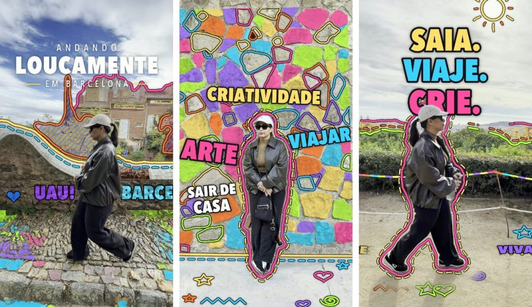

# Desenhos animados — skill para o Claude Code

Desenhos coloridos animados por cima do cenário real do seu vídeo, como um caderno de desenho que ganhou vida — e você sempre na frente.



- **Linhas tremidas** coloridas com borda escura contornando muro, prédios, árvores, vegetação e você
- **Parede em mosaico**: as pedras (ou azulejos) acendem em cores numa onda que sai de você
- **Rabiscos no chão**: estrelas, corações, espirais e zigue-zagues "deitados" na rua
- **Cordinha listrada, sol desenhado, árvores hachuradas**
- **Título de filme** (pequena / GRANDE / pequena), **palavras pipocando** presas à parede e **frase final** grande
- Tudo **preso ao lugar**: quando a câmera mexe, a tinta e as palavras andam junto com o cenário

Funciona em dois tipos de vídeo:

| Tipo | Quando | Exemplo |
| --- | --- | --- |
| **Parede** | Você parada ou encostada numa parede/fachada; câmera parada ou na mão | Parede de pedra virando mosaico, palavras em volta |
| **Câmera acompanhando** | Você andando e o cenário passando de lado | Muro, prédios, árvores, cerca e chão desenhados |

Veja todos os efeitos, um a um, no **[guia com imagens](guia/README.md)**.

## Como instalar

1. Tenha o [Claude Code](https://claude.com/claude-code) num **Mac** com `ffmpeg` e Python 3:
   ```bash
   brew install ffmpeg
   pip3 install numpy opencv-python pillow
   ```
2. Para as etapas de IA (reconhecer pedras e regiões do cenário), crie um ambiente Python uma vez só:
   ```bash
   python3 -m venv ~/.venv-desenhos
   ~/.venv-desenhos/bin/pip install torch torchvision transformers scipy opencv-python pillow
   ```
3. Baixe o repositório [skills-publicas](https://github.com/mikmachado/skills-publicas) e copie esta pasta para as skills do Claude:
   ```bash
   git clone https://github.com/mikmachado/skills-publicas.git
   mkdir -p ~/.claude/skills
   cp -R skills-publicas/edicao-de-video/desenhos-animados ~/.claude/skills/
   ```
4. Abra o Claude Code numa pasta de trabalho e peça, por exemplo:
   > "Faz desenhos animados neste vídeo. Tema: criatividade, arte, sair de casa e viajar."

   > "Deixa a parede em mosaico colorido, com o título A ARTE DE / SAIR DE CASA / E VIAJAR e a frase final SAIA. VIAJE. CRIE."

## Dicas de gravação

- Vertical (9:16), 1080×1920, 30 fps.
- **Parede**: fique encostada numa parede com textura (pedra, tijolo, azulejo). Câmera parada ou na mão, sem girar muito.
- **Andando**: a câmera acompanha de lado, com céu, prédios, árvores ou muro aparecendo. Funciona melhor com cenário variado.
- Diga ao Claude o tema das palavras, o título e a frase final — senão ele sugere.

## O que você recebe

- O vídeo em qualidade cheia e uma **versão pra postar** (~20–25 MB, cabe no envio pro celular), com o som original.
- Uma prévia de alguns quadros antes do vídeo inteiro, pra você ajustar palavras, cores e tempos.
