# Guia: desenhos animados

Desenhos coloridos animados por cima do cenário real, com a pessoa sempre na frente. Abaixo, os três vídeos feitos com a skill e cada efeito separado.

## Os vídeos

**Andando em Barcelona** (câmera acompanhando): título de filme no céu, prédios contornados em rosa, palavras pintadas no muro que passa e uma frase no céu.

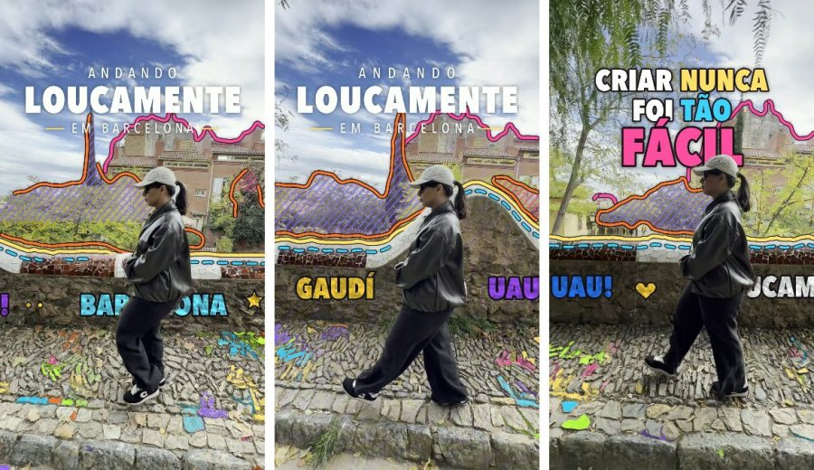

**A arte de sair de casa** (parede): a parede de pedra acende em onda, as palavras pipocam em volta e termina com "SAIA. VIAJE. CRIE.".

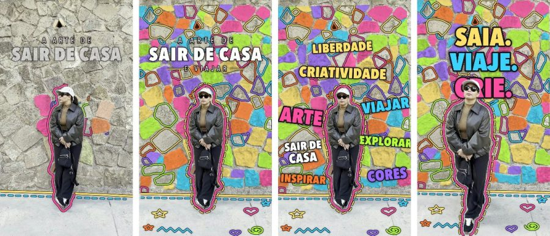

**A arte de explorar** (câmera acompanhando): sol desenhado, cidade e vegetação contornadas, cordinha listrada, rabiscos no chão e palmeira hachurada.

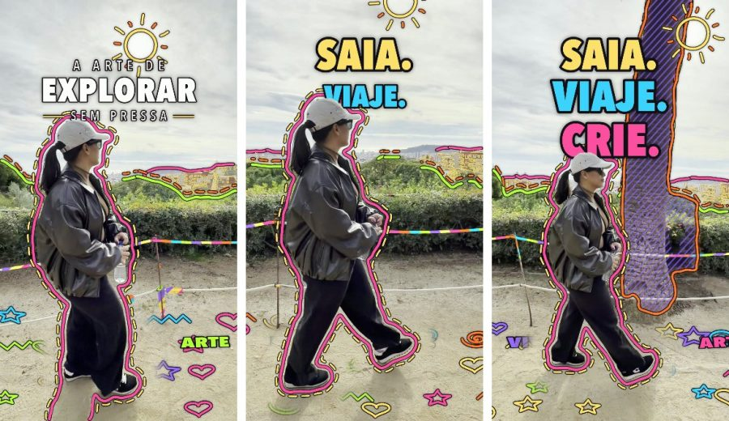

## Os efeitos

### Parede em mosaico colorido
As pedras são recortadas uma a uma (com IA). Cerca de 2/3 ganham tinta numa onda que sai da pessoa, com um flash branco quando acendem; as outras ganham contorno colorido.

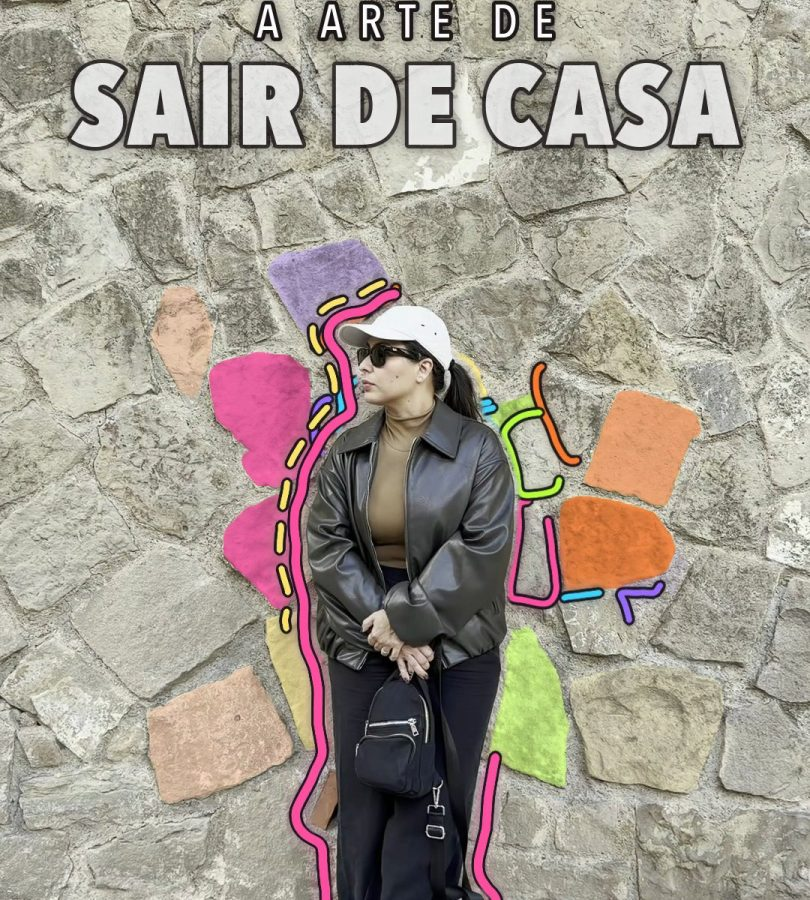

### Contorno da pessoa
Linha rosa colada no corpo + eco amarelo tracejado andando, que acompanha quando a pessoa se mexe.

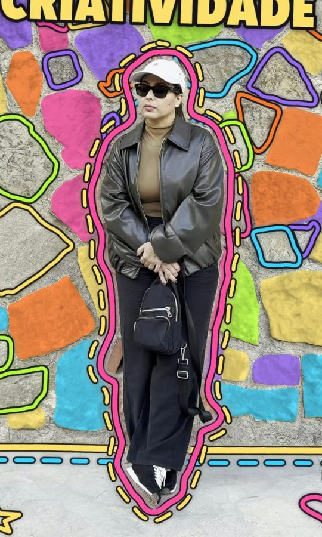

### Linhas no cenário
Rosa nos prédios onde encostam no céu, janelas em amarelo, verde-limão no topo da vegetação com eco laranja tracejado.

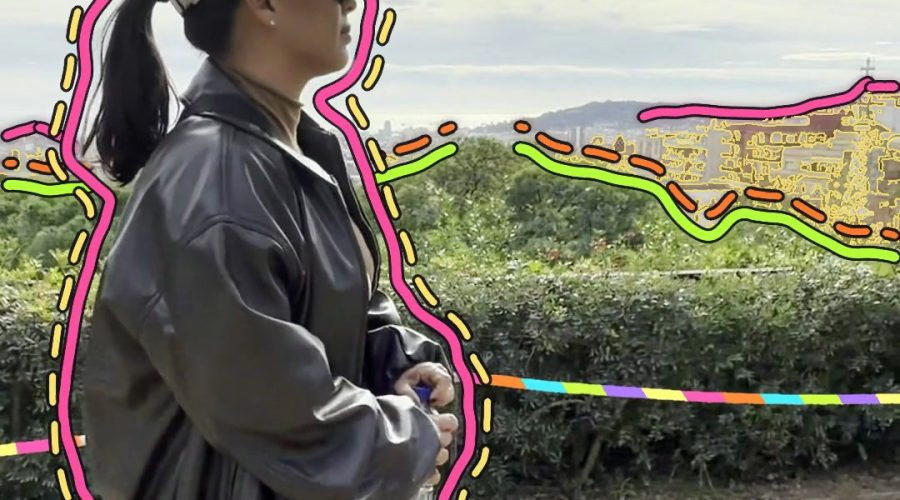

### Cordinha listrada e sol desenhado
A cordinha da cerca vira listrada de colorido, presa ao lugar. O sol de verdade ganha círculo e raios girando.

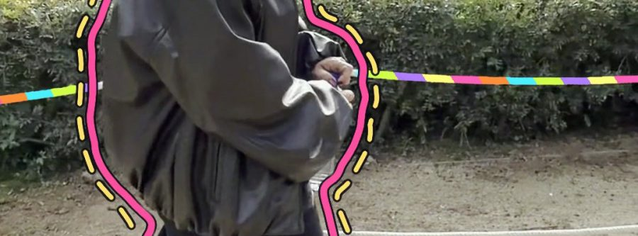

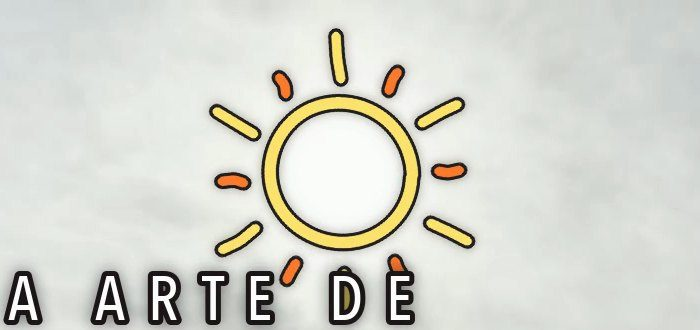

### Árvores e palmeiras hachuradas
Contorno laranja + hachura diagonal colorida cobrindo de cima pra baixo.

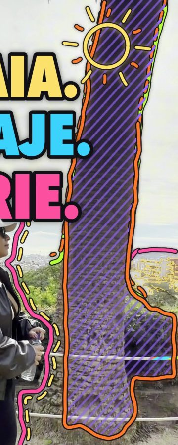

### Rabiscos no chão
Estrelas, corações, espirais, zigue-zagues e palavras curtas "deitados" no chão, presos ao lugar e longe dos pés.

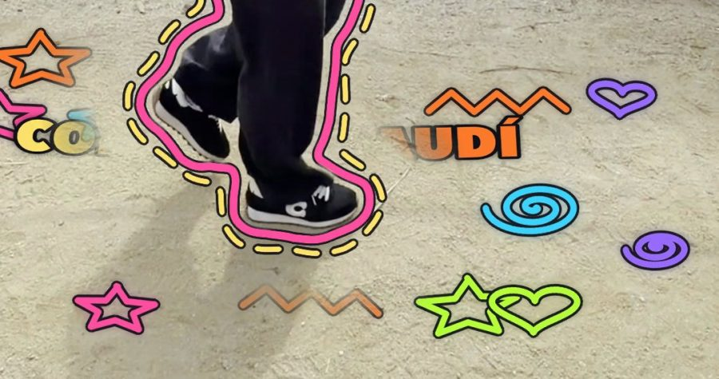

### Título de filme
Três linhas (pequena / GRANDE / pequena), letras se espaçando devagar e filetes amarelos crescendo dos lados, entre ~0,5 s e ~4,5 s.

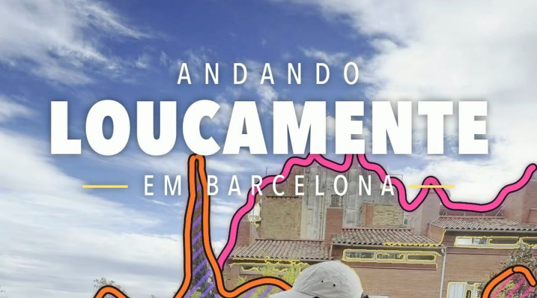

### Palavras pipocando e frase final
Palavras curtas entram uma por vez com rebote leve, em volta da pessoa. No fim, uma frase grande empilhada.

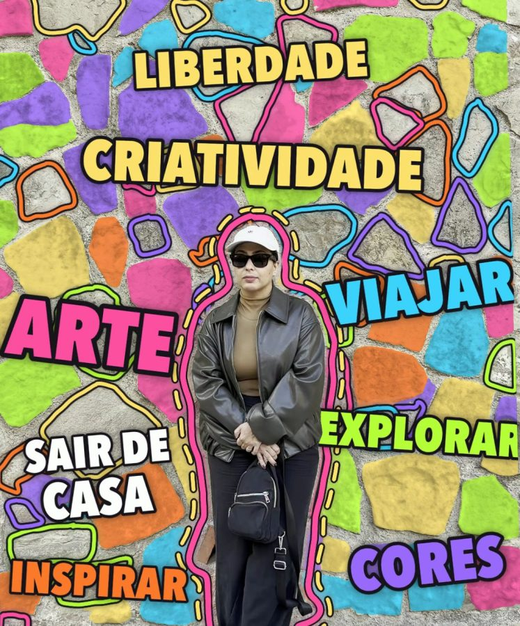

## Cuidados que a skill já toma

- Linha branca some em cenário claro → todas as linhas são coloridas com borda escura.
- Falhas no tênis quando a pessoa anda → nada colorido perto dos pés.
- Frase longa num muro que passa lê de trás pra frente → no muro só palavras curtas; frase longa vai no céu.
- Buraco sem cor quando a pessoa sai do lugar → a parede é reconhecida em dois momentos do vídeo.

Para instalar e pedir, veja o [README da skill](../README.md).
