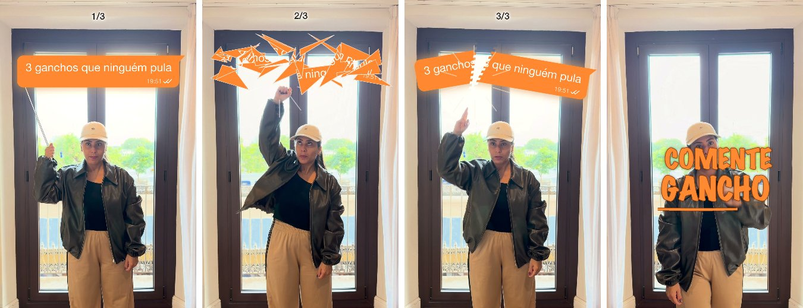

# Ganchos no balão — skill para o Claude Code

Um **balão de mensagem** (estilo WhatsApp) com a sua frase-gancho fica acima da sua cabeça, e você o **destrói de 3 jeitos**, um por trecho, com o contador **1/3 · 2/3 · 3/3** no topo:

- **1/3 cordinha**: o balão começa apagado; você puxa uma cordinha imaginária e ele acende piscando
- **2/3 murro**: soco para cima, o balão quebra em cacos de vidro que chovem, e um cai na sua cabeça
- **3/3 tesoura**: dedos em V cortam o balão em zigue-zague e as duas metades caem girando. Também tem o **cutucão** (o dedo estoura com fumaça) e o **apagar** (a mão passa por trás e a mensagem some)
- **final**: você escreve o CTA no ar com o dedo (ex.: COMENTE / GANCHO) e as letras nascem na ponta do dedo, sempre na frente de tudo, como se fossem escritas na lente

Os efeitos ficam presos aos **seus gestos de verdade**. O Claude marca o punho, o murro e a tesoura, rastreia a ponta do dedo quadro a quadro com o Vision da Apple, mostra prévias e entrega o vídeo com efeitos sonoros (clique, vidro, toc, tesoura, rasgo, pop). Vídeo **HDR do iPhone continua HDR**. A skill também entrega uma versão pronta para postar (−14 LUFS).



[Guia com imagens de cada efeito](guia/README.md)

## Como instalar

1. Tenha o [Claude Code](https://claude.com/claude-code) num **Mac** com `ffmpeg`, Python 3 e o `swiftc`:
   ```bash
   brew install ffmpeg
   pip3 install numpy opencv-python pillow
   xcode-select --install
   ```
2. Para o recorte da pessoa (uma vez, ~2 GB):
   ```bash
   python3 -m venv ~/.venv-ganchos && ~/.venv-ganchos/bin/pip install torch transformers pillow opencv-python
   ```
3. Baixe o repositório [skills-publicas](https://github.com/mikmachado/skills-publicas) e copie esta pasta para as skills do Claude:
   ```bash
   git clone https://github.com/mikmachado/skills-publicas.git
   mkdir -p ~/.claude/skills
   cp -R skills-publicas/edicao-de-video/ganchos-balao ~/.claude/skills/
   ```
   (ou **Code → Download ZIP**, descompacte e copie a pasta `edicao-de-video/ganchos-balao` para `~/.claude/skills/`)
4. Abra o Claude Code numa pasta de trabalho e peça, por exemplo:
   > "Edita com a skill ganchos-balao. Mensagem do balão: '3 ganchos que ninguém pula'. Final escrito: COMENTE / GANCHO. Cor laranja. No 3/3 eu faço tesoura. O venv do recorte está em ~/.venv-ganchos."

## Dicas de gravação

- Vertical (9:16), **câmera parada**, corpo inteiro ou da cintura para cima, com **bastante espaço acima da cabeça** (o balão fica ali).
- **Uma ação por vez**, com uma pausinha entre elas: cordinha, murro, gesto do 3/3 e escrita.
- **Cordinha:** estique o braço, feche a mão como se pegasse a bolinha e puxe até o peito.
- **Murro:** o punho vai bem alto, onde estaria a base do balão. Depois reaja (mão na cabeça, se encolher).
- **Tesoura:** levante os dedos em V até a base do balão e abra e feche 3 ou 4 vezes.
- **Escrita:** devagar, na altura do peito, duas linhas da esquerda para a direita, com um sublinhado no fim. Com a câmera traseira, a skill espelha só esse trecho.
- Frase-gancho com número e promessa, numa linha só (ex.: "3 ganchos que ninguém pula").

Os efeitos sonoros em `sfx/` são sintetizados por `scripts/gerar_sfx.py` e livres para usar. Para usar os seus, troque os .wav mantendo os nomes.

Feito com o Claude.
