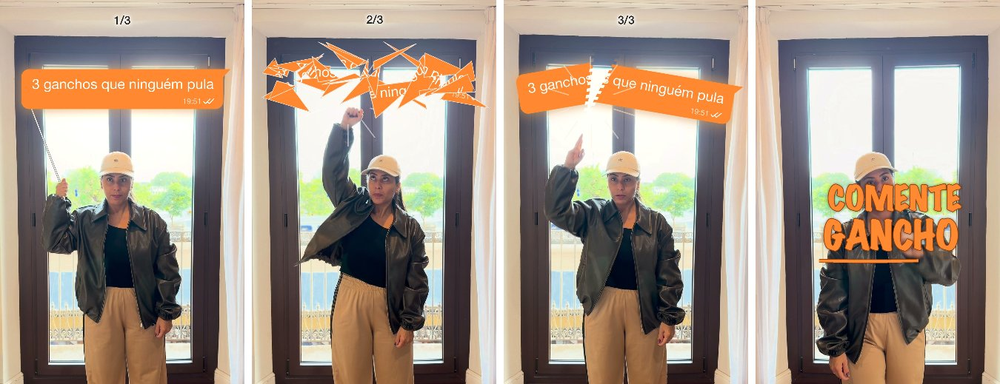
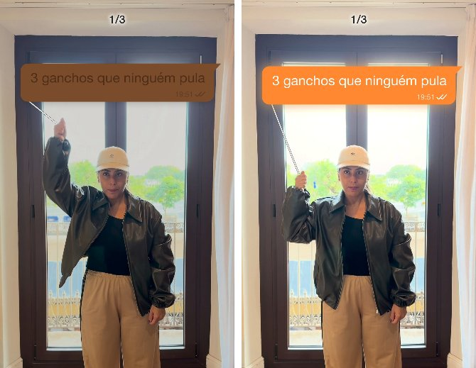
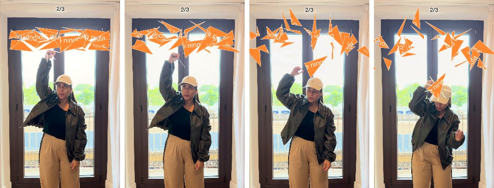
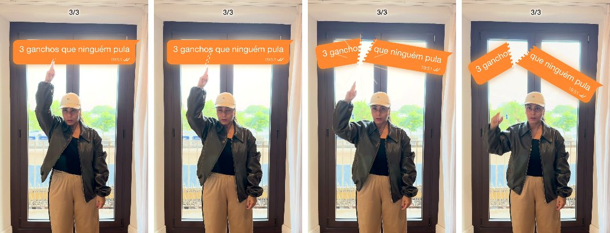
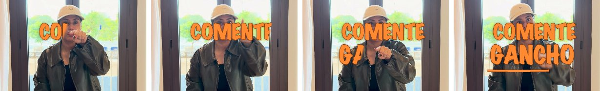
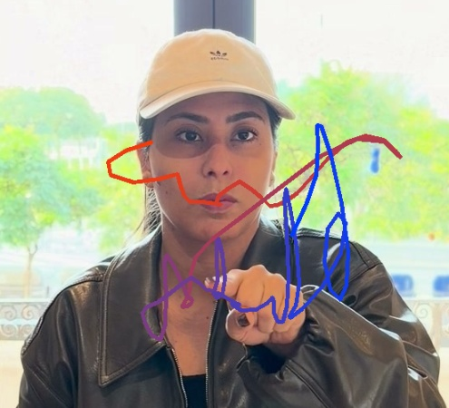

# Guia: ganchos no balão

Um balão de mensagem com a frase-gancho é destruído de 3 jeitos, seguindo os gestos reais da pessoa, e o vídeo fecha com o CTA escrito no ar com o dedo. Abaixo, o vídeo feito com a skill e cada efeito separado.

## O vídeo

**3 ganchos que ninguém pula** (corpo inteiro, câmera traseira parada): cordinha, murro e tesoura, e "COMENTE / GANCHO" escrito com o dedo.

## Os efeitos

### 1/3 — Cordinha
O balão começa apagado. Uma cordinha sai do canto dele até dentro do punho, que é rastreado quadro a quadro. Quando o puxão termina, o balão acende piscando (clique, clique) e joga luz na cena.

### 2/3 — Murro
No quadro em que o punho bate na base, o balão vira cacos de vidro (com o texto junto) que voam em leque e caem com gravidade, com estrela de impacto e tremida. Um caco grande vai direto na cabeça, no instante em que a pessoa se encolhe ("toc").

### 3/3 — Tesoura
A cada fechada dos dedos em V, o corte em zigue-zague sobe um pouco pelo balão (som de tesoura). No fim, ele se parte em duas metades que caem girando (rasgo de papel). Alternativas: **cutucão** (o dedo estoura em fumaça e pedaços) e **apagar** (a mão passa por trás e a mensagem some antes de estourar).

### Final — escrita no ar
A ponta do indicador é rastreada em todos os quadros (Vision da Apple). A letra avança quando o dedo anda e para quando ele para. Cada linha fica encaixada na faixa onde o dedo escreve, então a letra nasce na ponta dele. O texto fica sempre na frente de tudo, como se fosse escrito na lente.

O caminho do dedo no ar (do azul ao vermelho, no tempo):

## O que deu errado no caminho (e a skill já evita)

- **Letras atrás da mão parecem falha.** A escrita fica sempre na frente, sem máscara.
- **Marcar o dedo "a olho" desincroniza.** O rastreio é quadro a quadro, pelo Vision.
- **Na hora de apagar, a mão vai atrás do balão**, senão cobre a mensagem.
- **O efeito segue o gesto que a pessoa fez** (era tesoura, e não o tapa da referência).
- **Vídeo do iPhone continua HDR.** Tratado como SDR, ele fica apagado.
