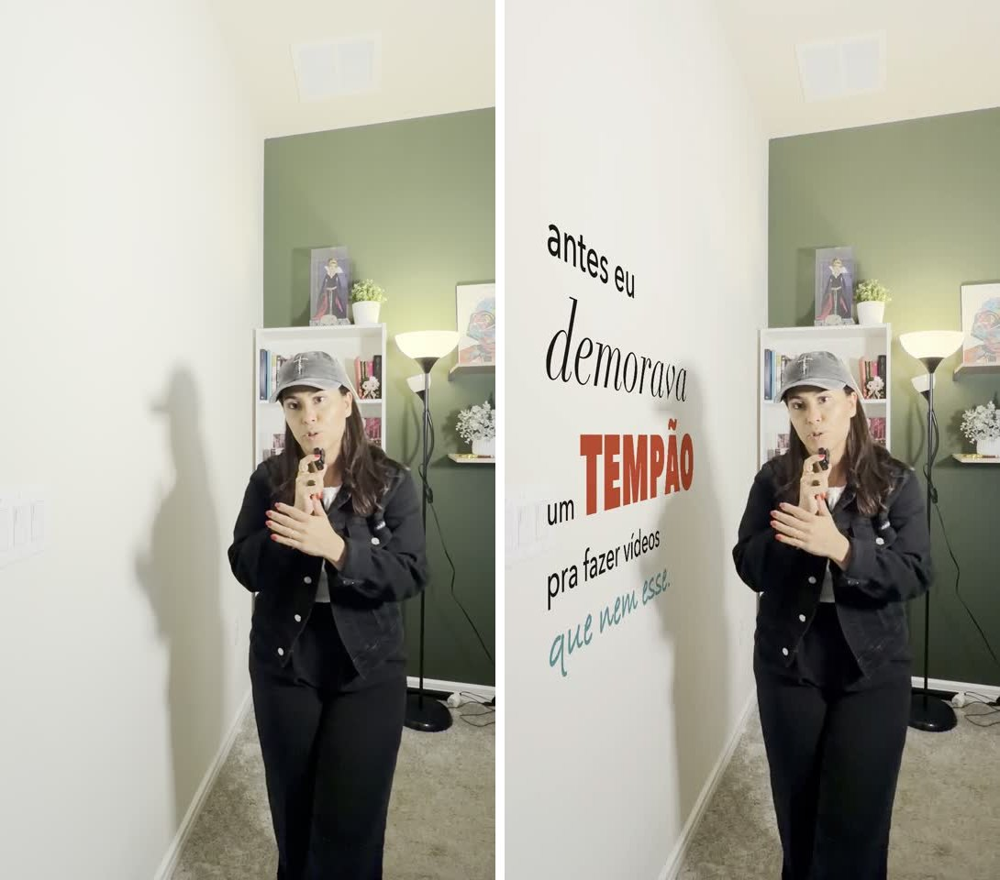
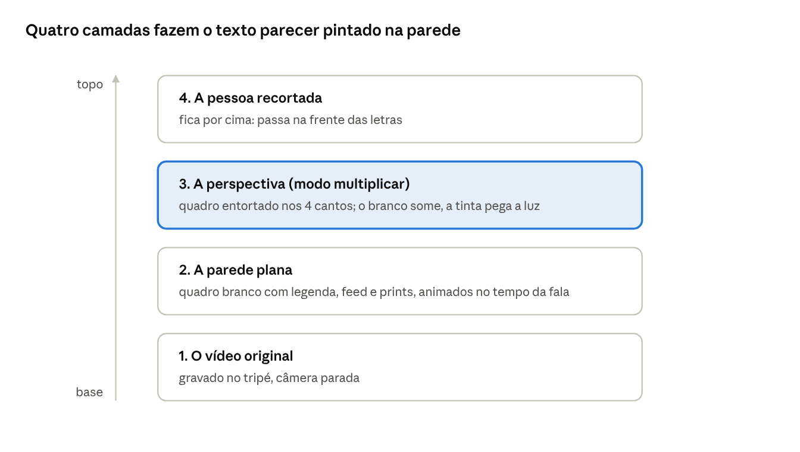
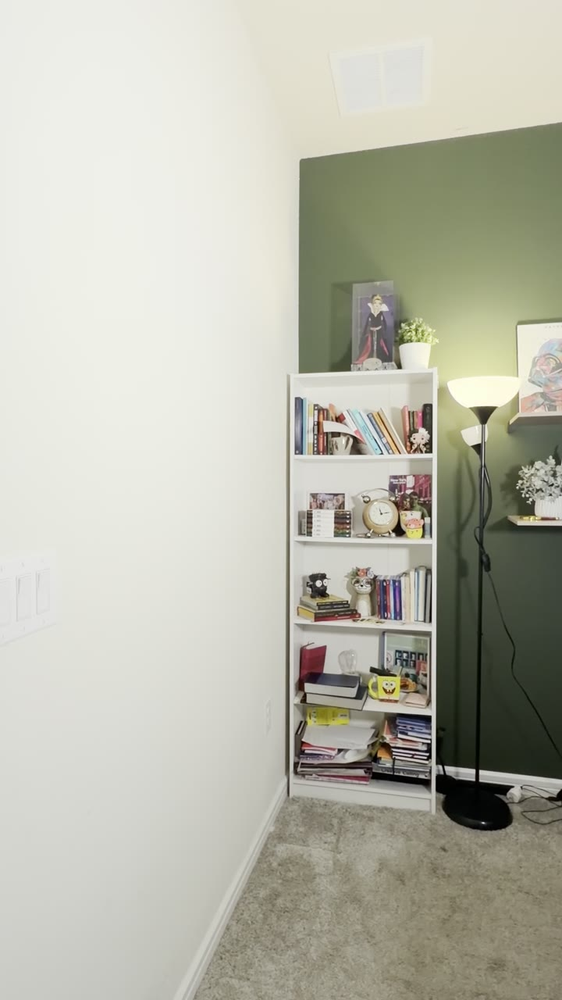
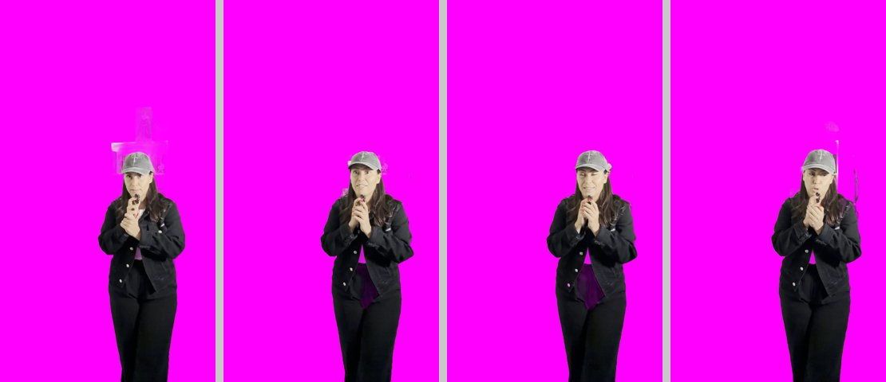
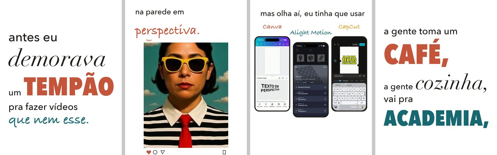
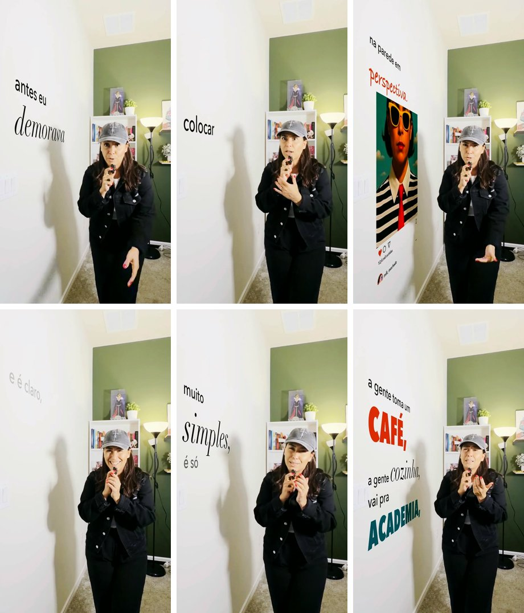

# Texto na parede em perspectiva com o Claude

Criado por Mik Machado · Instagram [@mik_machado](https://www.instagram.com/mik_machado/) · skill gratuita neste repositório.

## O que é o efeito

Você grava um vídeo falando na frente de uma parede, e a legenda aparece **pintada na parede, em perspectiva**, com você passando na frente das letras. Na mesma parede dá para colocar imagens, prints e até vídeos tocando, como um feed de Instagram rolando.



*Antes e depois, no mesmo segundo do vídeo: a legenda pega a sombra da pessoa e acompanha a perspectiva da parede.*

O truque tradicional usa três apps no celular: o **CapCut** para escrever o texto, o **Alight Motion** para girar o cartão até ele "deitar" na parede (efeito Flip Layer) e o **Canva** (app Transform Image) como alternativa para deformar o texto. Depois, de volta no CapCut, entram o chroma key, o modo de mistura **Escurecer** e um recorte da pessoa por cima. Funciona, mas é uma inserção por vez e dá um trabalhão.

Com o Claude você grava, entrega o vídeo e descreve o que quer. Ele mede a parede, escreve a legenda inteira no ritmo da fala, cola tudo em perspectiva, faz os cortes e devolve o vídeo pronto e as camadas separadas para ajustar no CapCut.

A ideia toda cabe em quatro camadas empilhadas, de baixo para cima:

1. **O vídeo original**, com a câmera parada.
2. **A parede "plana"**: um quadro branco onde o texto, as imagens e os vídeos são desenhados retos, sem perspectiva.
3. **A perspectiva**: esse quadro é entortado até encaixar nos 4 cantos da parede e misturado no modo *multiplicar*. O branco some e só a tinta fica, pegando a luz e a sombra da parede.
4. **A pessoa recortada** por cima de tudo, para passar na frente do texto.



A camada 3 é a que faz a mágica: sem o modo multiplicar, o texto parece um adesivo colado por cima do vídeo.

## O que você precisa

| Item | Para quê | Como conseguir |
| --- | --- | --- |
| Claude Code (app desktop ou terminal) | O agente que roda os comandos e edita no seu computador | [claude.com/claude-code](https://claude.com/claude-code), plano Pro ou Max |
| ffmpeg | Cortar, juntar e exportar vídeo | `brew install ffmpeg` no Mac (o Claude instala se você pedir) |
| Python 3 com Pillow e numpy | Desenhar o texto e entortar a parede | `pip3 install pillow numpy` |
| Whisper (faster-whisper) | Transcrever a fala com o tempo de cada palavra | `pip3 install faster-whisper` |
| Recorte da pessoa | Deixar a pessoa na frente do texto | O Vision da Apple, que já vem no macOS |
| A skill **texto-em-perspectiva** | Ensina o Claude o método e traz os scripts prontos | Este repositório: copie a pasta `texto-em-perspectiva` para `~/.claude/skills/` |

### Instalar a skill em 3 comandos

No Terminal do Mac:

```bash
git clone https://github.com/mikmachado/skills-publicas.git
mkdir -p ~/.claude/skills
cp -R skills-publicas/edicao-de-video/texto-em-perspectiva ~/.claude/skills/
```

Sem terminal: no GitHub, clique em **Code → Download ZIP**, descompacte e arraste a pasta `texto-em-perspectiva` para `~/.claude/skills/`. A skill funciona no macOS. Se faltar ffmpeg ou Python, peça ao Claude: "instala o que a skill texto-em-perspectiva precisa".

### Como gravar o vídeo bruto

A gravação decide 80% do resultado. Siga estas regras:

- **Celular no tripé, sem mexer.** Os cantos da parede ficam fixos; se a câmera andar, o texto escorrega.
- **Uma parede clara e lisa** ocupando um bom pedaço do quadro, de lado (em perspectiva), não de frente.
- **Fique longe da parede**, de preferência na frente da parte mais distante dela. Assim a área perto da câmera fica livre para o texto.
- **Comece com 1 a 2 segundos de parede vazia** antes de entrar no quadro. Isso ajuda no recorte.
- **Deixe aparecer uma quina, o rodapé ou o teto.** Essas linhas mostram ao Claude para onde a parede "foge".
- Grave em 9:16 (vertical) e fale com pausas naturais: elas viram os cortes.



*O cenário ideal: parede clara de lado, ocupando a esquerda do quadro, com o rodapé e a quina visíveis. Esses 2 segundos de parede vazia abrem o vídeo.*

## Passo a passo com o Claude

São 9 etapas. Você só conversa e revisa; quem roda os comandos é o Claude. Em cada etapa, peça para ele **te mostrar uma imagem** do resultado antes de seguir.

1. **Preparar a base.** O Claude converte o vídeo para 1080×1920, 30 qps. Todas as medidas da parede passam a valer nesse tamanho.
2. **Transcrever com tempo por palavra.** O Whisper gera o texto e o segundo exato de cada palavra. **Revise os nomes próprios:** no nosso teste ele ouviu "cloud" em vez de Claude e "a Light Motion" em vez de Alight Motion.
3. **Medir a parede.** O Claude tira um quadro do vídeo, desenha uma grade com coordenadas e acha os 4 cantos da área onde o texto vai. Para uma parede inteira, ele acha o **ponto de fuga** cruzando o rodapé com o teto. Peça para ver o quadrilátero desenhado sobre a imagem: ele tem que "deitar" na parede.
4. **Recortar a pessoa.** Cada quadro vira uma máscara (branco = pessoa). Só importa o recorte **dentro da área da parede**. Erros na estante ou no fundo não aparecem.
5. **Desenhar a parede plana.** É aqui que mora a criatividade. Num quadro branco, o Claude anima tudo no tempo da fala:
   - a legenda, uma frase por tela, palavra por palavra, misturando fontes e tamanhos (palavra-chave grande, palavra emotiva em itálico, fecho em letra de mão);
   - um feed de posts subindo como no celular quando a pessoa fala "imagens, vídeos";
   - prints de apps quando eles são citados.
6. **Colar em perspectiva.** O quadro branco é entortado até os 4 cantos e misturado no modo **multiplicar**. O branco some, as letras pegam a sombra da pessoa e a luz do quarto, e a máscara coloca a pessoa na frente.
7. **Cortar.** Um corte por frase, tirando as pausas. As frases longas ganham um corte no meio e os planos alternam entre aberto, aproximado e close nas reações. **Corte depois de colar a parede:** assim o zoom move tudo junto e o texto não escorrega.
8. **Trilha e efeitos.** Música que abaixa sob a voz, um "pop" nas palavras grandes, um whoosh quando o feed entra e um clique de rolagem.
9. **Revisar e entregar.** O Claude monta uma folha de quadros para você bater o olho e entrega o vídeo final, a camada da parede com transparência (com os mesmos cortes) e a música e os efeitos separados, para ajustar no CapCut.

### Cada etapa em imagens

**Etapa 3 · Medir a parede.** A grade dá as coordenadas e o quadrilátero amarelo (A, B, C, D) marca onde o texto vai. As bordas de cima e de baixo apontam para o mesmo ponto de fuga do rodapé.


**Etapa 4 · Recortar a pessoa.** A pessoa sobre fundo magenta mostra onde o recorte falha. Aqui os erros ficaram em cima da cabeça, na estante, fora da parede, e por isso não aparecem no vídeo final.



**Etapa 5 · Desenhar a parede plana.** É assim que o texto existe antes da perspectiva: reto, sobre branco, com fontes e tamanhos misturados, o feed de posts e os prints dos apps.



**Etapa 6 · Colar em perspectiva.** O mesmo conteúdo, entortado para os cantos da parede e misturado no modo multiplicar, com a pessoa na frente.



## Prompts prontos

Copie, troque o que está entre colchetes e cole no Claude Code. Dá para mandar tudo de uma vez (prompt 1), mas, na primeira vez, vá etapa por etapa para aprender a revisar.

**1. O pedido completo**

```
Use a skill texto-em-perspectiva no vídeo [caminho do vídeo]. Coloque toda a legenda do que eu falo na parede [branca da esquerda], em perspectiva, palavra por palavra, misturando fontes e tamanhos (palavras-chave grandes em caixa alta, palavras emotivas em itálico serifado, fechos em letra de mão). Eu tenho que passar na frente do texto. Quando eu falar de [imagens e vídeos], mostre [meus posts] subindo na parede como um feed rolando no celular. Deixe o vídeo dinâmico com cortes nas pausas e zooms alternados. Me mostre uma folha de quadros antes de entregar.
```

**2. Conferir a parede**

```
Me mostre o quadrilátero da parede desenhado sobre um quadro do vídeo, com a grade de coordenadas. As bordas de cima e de baixo têm que seguir o rodapé e o teto.
```

**3. Corrigir a transcrição**

```
Antes de desenhar, me mostre a transcrição. Corrija: [cloud → Claude, a Light Motion → o Alight Motion]. Se alguma palavra estiver estranha, transcreva só aquele trecho de novo.
```

**4. Auditar o recorte**

```
Monte uma folha com um quadro a cada 2 segundos do vídeo inteiro, comigo recortada sobre fundo magenta, e me diga onde o recorte falha dentro da área da parede.
```

**5. Ajustar o visual da legenda**

```
Me mostre 4 telas da parede plana (sem perspectiva) antes de renderizar. Quero [as palavras-chave em terracota e petróleo / a letra maior / menos palavras por tela].
```

**6. Entrega para editar no CapCut**

```
Exporte também a camada da parede com transparência (ProRes 4444) com os mesmos cortes do vídeo final, e a música e os efeitos em arquivos separados.
```

## Erros comuns e como corrigir

| O que aparece | Por que acontece | Como corrigir |
| --- | --- | --- |
| O texto escorrega ou treme na parede | A câmera se mexeu, ou o zoom foi feito antes de colar a parede | Gravar no tripé; colar a parede primeiro e cortar e dar zoom depois |
| O texto parece flutuar, não "deita" na parede | Cantos errados | Pedir a grade com o quadrilátero e ajustar até as bordas seguirem rodapé e teto |
| As letras ficam esticadas ou achatadas | A proporção do quadro plano não bate com a área real da parede | Calcular a área pelo ponto de fuga (a skill faz isso) |
| Pedaços da pessoa somem ou o texto passa por cima da mão | Recorte falhou naquele quadro | Auditar sobre magenta no vídeo todo; usar os segundos de parede vazia para reforçar o recorte |
| Palavra cortada na borda do quadro | O zoom de close cortou a parte perto da câmera | Prender o zoom do close na borda da parede, ou usar letra menor naquela tela |
| Texto ilegível | Muitas palavras por tela, ou texto atrás da pessoa | Uma frase por tela, texto no lado perto da câmera, longe de onde a pessoa fica |
| Nome errado na legenda | A transcrição errou nomes próprios | Revisar a transcrição antes de desenhar (prompt 3) |
| Cor amarelada ou apagada | Grade de cor exagerada | Pedir branco neutro na parede e pretos firmes; comparar com uma referência |

## Dá para fazer com outro agente de IA?

Sim. O método não depende de nenhum recurso exclusivo do Claude, e sim de ferramentas abertas (ffmpeg, Python, Whisper) e de um agente que consiga usá-las. O agente precisa de quatro coisas:

1. **Rodar comandos no seu computador** (terminal), porque o vídeo é processado localmente.
2. **Ler e escrever arquivos** na pasta do projeto.
3. **Enxergar imagens**: é olhando a grade e as folhas de quadros que ele acha os cantos e revisa o resultado. Sem visão, você vira os olhos dele.
4. **Aguentar tarefas longas** de vários passos, com renderizações de alguns minutos.

| Tipo de agente | Exemplos | Funciona? | O que muda |
| --- | --- | --- | --- |
| Agente de terminal | Claude Code, OpenAI Codex CLI, Gemini CLI | Sim | Mesmo fluxo. A skill é um arquivo de texto (SKILL.md) com os scripts; em outro agente, cole o conteúdo nas instruções do projeto (por exemplo um AGENTS.md ou GEMINI.md) |
| Agente dentro de editor de código | Cursor, GitHub Copilot (modo agente), Windsurf | Sim | Mesmo fluxo pelo terminal integrado; você abre a pasta do projeto no editor |
| Chat com execução de código na nuvem | ChatGPT (análise de dados), Claude.ai com análise | Em parte | Limites de tamanho de arquivo e de tempo por execução; um vídeo de 1 minuto em 1080p costuma estourar. Serve para testar em um trecho curto |
| Chat sem execução | Qualquer chat só de texto | Não sozinho | Ele só escreve os scripts e você roda tudo à mão |

Em qualquer agente, os pontos que mais pesam no resultado são os mesmos: câmera parada, cantos bem medidos, recorte auditado e cortes feitos **depois** da parede colada. Na nossa experiência, o que mais diferencia os agentes é a capacidade de olhar as imagens e perceber sozinho o que ficou errado.

## Checklist em uma tela

- [ ] Gravei no tripé, com parede clara de lado e 2 s de parede vazia no começo
- [ ] Instalei Claude Code, ffmpeg, Python (Pillow, numpy, faster-whisper) e a skill
- [ ] Revisei a transcrição e corrigi os nomes próprios
- [ ] Conferi o quadrilátero da parede sobre o quadro
- [ ] Auditei o recorte sobre magenta, dentro da área da parede
- [ ] Aprovei 4 telas da parede plana (fontes, cores, tamanhos)
- [ ] Colei a parede **antes** de cortar e dar zoom
- [ ] Revisei a folha de quadros do vídeo final
- [ ] Recebi vídeo final, camada da parede, música e efeitos separados
