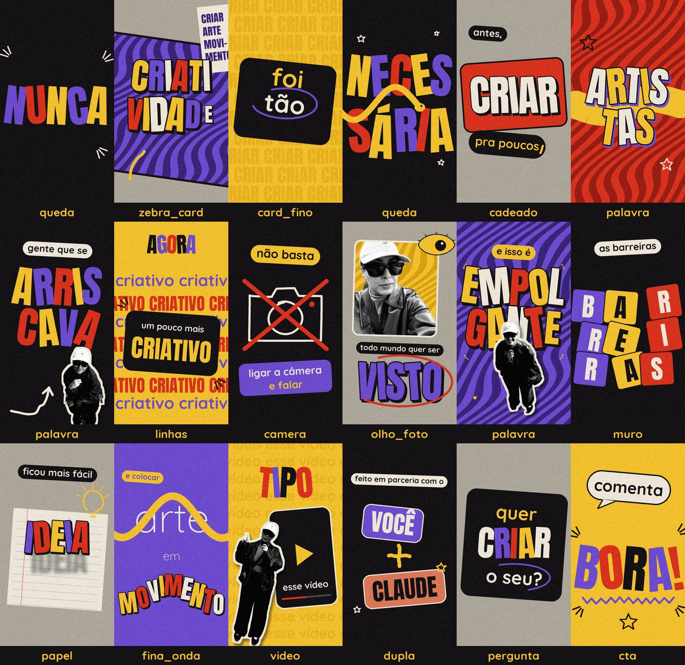

# Tipografia colagem: skill para o Claude Code

Você grava um **áudio** lendo um texto curto e o Claude transforma cada frase numa **cena de tipografia animada estilo colagem**, presa à palavra que você está falando. Não precisa filmar nada.

- **letras gigantes e condensadas** caindo uma a uma e quicando
- palavras **pipocando** com contorno e sombra, sobre **zebra roxa ou vermelha** que ondula
- cards pretos com **fonte fina** e **rabiscos amarelos à mão**: setas, círculos, cobra, estrelas, faíscas
- cenas especiais: **muro de letras que desaba**, palavra **saindo do papel**, **câmera riscada com X**, **olho que pisca**, balão de **"comenta"** e CTA final
- suas **fotos** viram recortes em P&B com borda de figurinha, **mexendo como GIF** (pulo, dança, tremor)
- grão de filme, tremidinha de câmera nos cortes, paleta roxo, amarelo, vermelho, preto e bege
- **som pronto**: a voz é limpa (corta pausas, 1.2x, tira ruído), com batida que abaixa sob a voz e efeitos em cada corte e letra (tudo sintetizado e livre para usar)



**[Guia passo a passo no Google Docs](https://docs.google.com/document/d/1UqCwEyEotVQPATRXD9flB9EHB0FqbsnvGBmbUTMTDAM/edit)**: roteiro, gravação, fotos, como pedir ao Claude, catálogo de cenas e como postar.

## Como instalar

1. Tenha o [Claude Code](https://claude.com/claude-code) num **Mac** com `ffmpeg`, Python 3 e o `swiftc`:
   ```bash
   brew install ffmpeg
   pip3 install numpy pillow faster-whisper
   xcode-select --install
   ```
2. Baixe o repositório e copie esta pasta para as skills do Claude:
   ```bash
   git clone https://github.com/mikmachado/skills-publicas.git
   mkdir -p ~/.claude/skills
   cp -R skills-publicas/edicao-de-video/tipografia-colagem ~/.claude/skills/
   ```
   (ou **Code → Download ZIP**, descompacte e copie a pasta `edicao-de-video/tipografia-colagem` para `~/.claude/skills/`)
3. Abra o Claude Code numa pasta de trabalho, mande o áudio (e as fotos, se quiser) e peça, por exemplo:
   > "Usa a skill tipografia-colagem. Esse é meu áudio e o roteiro é este: [texto]. Palavras de destaque: CRIATIVIDADE, VISTO, BORA. No fim, VOCÊ + CLAUDE."

## O que tem aqui

- `SKILL.md`: instruções para o Claude, com o catálogo dos 15 modelos de cena e o formato do `projeto.json`
- `scripts/preparar_audio.py`: transcreve com tempo por palavra, corta pausas, acelera e limpa a voz
- `scripts/recortar.py` + `seg.swift`: recorta a pessoa das fotos (Vision da Apple) e deixa em P&B
- `scripts/motor.py`: desenha os quadros (`--ver` para prévia)
- `scripts/audio.py`: batida, efeitos e mixagem
- `scripts/montar.sh`: gera o vídeo final, a versão leve e a `-POSTAR` (< 30 MB)
- `exemplos/criatividade.json`: o vídeo de referência inteiro, cena por cena
- `fontes/`: Anton e Quicksand (SIL Open Font License)

Feito com o Claude.
